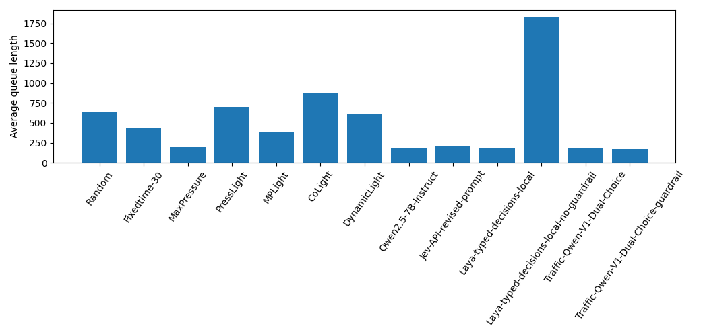
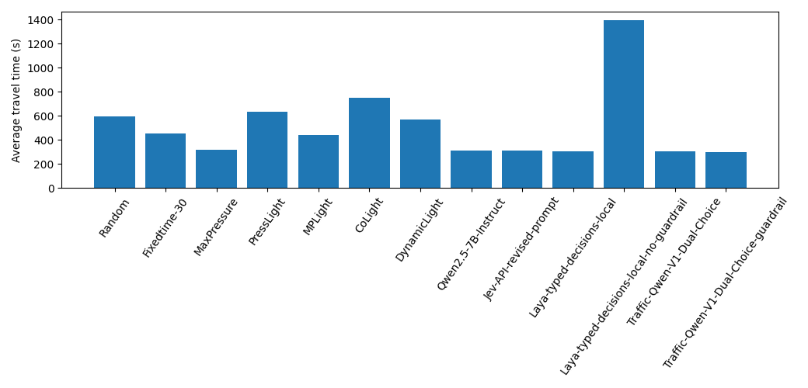
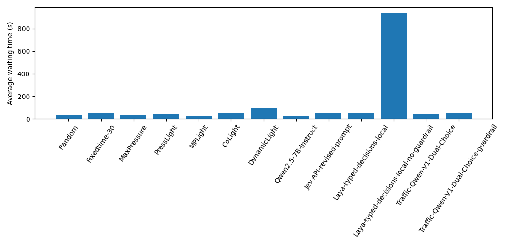

<video src="assets/traffic_qwen_inference.mp4" controls autoplay muted loop playsinline width="100%">
  Your browser does not support embedded video. [Open the Traffic-Qwen inference video](assets/traffic_qwen_inference.mp4).
</video>

# Traffic-Qwen Decision

Traffic-Qwen Decision is a local, non-generative decision controller for adaptive traffic signals. It adapts JevLight CityFlow control to Qwen3.5-0.8B using a 4-bit QLoRA adapter and Clef decision head. One inference emits two typed choice distributions from the same structured state: four phases and six green durations (15, 20, 25, 30, 35, 40 seconds). The CityFlow runner follows JevLight five-second decision ticks and five-second yellow transitions.

This repository packages the original Traffic-Qwen V1 Dual-Choice benchmark checkpoint and a separate, seed-paired retraining ablation. Its labels imitate actions applied by JevLight with guardrail; they are not optimal or counterfactual labels. It is supervised imitation, not reinforcement learning, zero-shot control, self-evolution, or evidence of deployment readiness.

## Why Traffic Signal Control Matters

Traffic signal management is a major real-world challenge because it directly affects urban mobility, air pollution, fuel consumption, road safety, and emergency response. Many existing systems still rely on fixed rules or simplified traffic information, even as cities gain access to larger volumes of traffic data and more capable AI tools.

With the rapid development of AI and the growing availability of city-scale traffic data, public agencies and industry are seeking smarter ways to manage traffic. Traffic-Qwen explores a lightweight AI-based approach that selects signal phases and green durations. Its goal is to improve on conventional rule-based control; the experiments reported here evaluate that approach in simulation and do not establish real-world deployment performance.

## Traffic-Qwen V1: How It Works

**Traffic-Qwen V1 is a decision model specialized for traffic signals.** It is based on Qwen3.5-0.8B, but it does not act as a chatbot during simulation: it directly selects control actions.

### What is the model based on?

It uses the legacy JevLight framework and the CityFlow simulator. At each decision, it receives a structured intersection state describing traffic conditions such as queues, waiting times, and the current phase. It produces two choices:

- one of four signal phases;
- one of six green durations: 15, 20, 25, 30, 35, or 40 seconds.

The decisions follow the JevLight protocol: the simulator advances in five-second steps, and a phase change includes a five-second yellow transition.

### How was it trained?

V1 was fine-tuned with **4-bit QLoRA using Unsloth**, with a Clef-style decision head. It learned by imitation from **1,065 decisions** collected from a JevLight/Laya run with guardrail: 792 training examples, 130 validation examples, and 143 test examples.

The model therefore learned to reproduce choices found in those data. This was not reinforcement learning in CityFlow, and the imitated decisions are not necessarily optimal. The dataset comes from one Jinan scenario and its duration labels are imbalanced.

### How does it work in simulation?

The model maps the traffic state to probability distributions over phases and durations. The controller then selects the most probable option and applies it in CityFlow, with or without the guardrail depending on the experiment. Both outputs are predicted from the same state, but phase and duration are selected separately.

### What do the Jinan experiments show?

On the Jinan 3×4 scenario simulated for 3,600 seconds, the **no-guardrail** version achieved an average queue of **189.96**, average waiting time of **46.71 s**, and average travel time of **303.12 s**. It made **1,262 phase changes**, with no fallback requests or guardrail corrections. The video above replays this recorded simulation; it is not live inference. The replay shows the network, vehicles, and signal states.

These results show that the model can vary its phases and avoid the catastrophic phase lock observed with generic Laya without a guardrail. They do not establish general superiority: on this episode, MaxPressure had a lower average waiting time (**30.76 s**), and the V1 results do not demonstrate generalization to other cities or scenarios.

### Future outlook

The next step is to improve the data and learning method: collect varied episodes, address the duration imbalance, and test reinforcement learning in CityFlow. Controllers should be compared on the same scenarios across multiple episodes and seeds before claiming an improvement.

In the longer term, coordination between intersections, in the spirit of CoJevLight, could help improve traffic flow across an entire network. This requires a suitable network-level state, a shared objective, and dedicated experiments in CityFlow or SUMO. Traffic-Qwen V1 is an initial specialized decision baseline, not a system validated for real-world deployment.

## Benchmark Scope and JevLight Version

Traffic-Qwen V1 was developed, trained, and evaluated using JevLight's CityFlow-based benchmark protocol. The [public JevLight repository](https://github.com/usail-hkust/JevLight) describes JevLight as a CityFlow traffic-signal-control framework and reports the Jinan benchmark in `results/benchmark_jinan.json`. Traffic-Qwen uses the Jinan 3×4 network, a 3,600-second simulation horizon, and the benchmark's average queue length, average waiting time, and average travel time metrics.

These results should be interpreted within that preserved CityFlow benchmark scope. Traffic-Qwen V1 has not been evaluated under SUMO or CoJevLight, and the results below do not describe either system. Any future SUMO evaluation will be a separate experiment and will require its own matched baseline protocol.

In summary:

- Traffic-Qwen V1 is evaluated against the CityFlow-based JevLight benchmark.
- Its comparisons with Laya, Jev, Qwen2.5-7B, MaxPressure, and the reported RL baselines remain valid within that benchmark scope.
- Traffic-Qwen V1 has not yet been evaluated under SUMO or CoJevLight.
- Evaluation under SUMO is planned as a separate future experimental stage.

## Measured result

The original Traffic-Qwen V1 benchmark checkpoint was trained on 1,065 guarded Jinan decisions from one episode (792 train, 130 validation, 143 chronological held-out test). Training took 637 seconds and peaked at 2.08 GiB VRAM. Offline test accuracy was 79.0% for phase and 97.2% for duration, while duration macro-F1 was 0.489 because labels are highly imbalanced. Temperatures were fit on validation for offline analysis only; the CityFlow controller used the model's uncalibrated distributions.

Jinan 3×4, 3,600 simulated seconds:

| Controller | Average queue | Average waiting (s) | Average travel (s) |
|---|---:|---:|---:|
| Traffic-Qwen V1 original benchmark checkpoint (no guardrail) | 189.96 | 46.71 | 303.12 |
| Traffic-Qwen V1 original benchmark checkpoint (guardrail) | 180.71 | 47.08 | 297.60 |
| Laya, guardrail | 191.39 | 47.36 | 303.87 |
| Laya, no guardrail | 1,823.44 | 943.76 | 1,395.36 |
| MaxPressure | 199.68 | 30.76 | 317.51 |
| Qwen2.5-7B-Instruct | 189.14 | 25.34 | 312.47 |

> **Scope note:** All Traffic-Qwen V1 comparisons reported below refer to the preserved CityFlow-based JevLight benchmark. They are not SUMO or CoJevLight results.

### Benchmark metrics

These figures show the original Traffic-Qwen V1 benchmark checkpoint alongside the published controller baselines.

| Average queue | Average travel time | Average waiting time |
|---|---|---|
|  |  |  |

Without guardrail, the original Traffic-Qwen V1 benchmark checkpoint used all four phases, switched phase 1,262 times, and retained the current phase on 1.94% of decisions. It chose only 20-second (739 times) and 40-second (560 times) durations. The trace-derived maximum non-service proxy was 900 seconds. Phase lock was removed, but residual starvation and duration-collapse remain concerns. For the original Traffic-Qwen V1 benchmark checkpoint with guardrail, 25 corrections and zero fallbacks were recorded. These results cover one seed and one episode; the chronological test segment is not an unseen-episode test.

> **Checkpoint note:** The headline benchmark and the paired ablation are separate experiments. The headline result uses the original Traffic-Qwen V1 checkpoint, whereas the paired ablation retrains one checkpoint per seed from the pinned Qwen3.5-0.8B base revision. The ablation results therefore demonstrate the effect of traffic specialization but do not replace the original cross-controller benchmark result.

The tracked results include the report, machine-readable metrics, comparison, offline evaluation, and figures. Full raw and compressed decision traces are retained locally under results/traces/ for audit, but are Git-ignored because redistribution terms for the Jinan-derived observations are unverified. The extended benchmark preserves the original JevLight schema; the original benchmark was not overwritten.

## Traffic Specialization Ablation

To isolate the effect of traffic-specific training, we compared three separately retrained Traffic-Qwen V1 ablation checkpoints against an untrained model with the same `Qwen3.5-0.8B` backbone and Clef decision architecture. Both arms were evaluated without guardrail corrections or request fallbacks.

The untrained arm uses the base Qwen/Clef decision model with an initialized decision head but no traffic-domain learning. Each trained arm is a separate checkpoint retrained with the same architecture using QLoRA on the 792 Traffic-Qwen V1 training examples for two epochs, with LoRA rank and alpha set to 16/16.

### Paired CityFlow results

| Seed | Controller | Average queue | Average waiting (s) | Average travel time (s) |
|---:|---|---:|---:|---:|
| 3407 | Untrained Qwen/Clef | 1,751.96 | 999.11 | 1,559.67 |
| 3407 | Traffic-Qwen V1 retrained ablation checkpoint — seed 3407 | 156.68 | 37.71 | 283.66 |
| 3408 | Untrained Qwen/Clef | 1,422.10 | 943.71 | 1,135.71 |
| 3408 | Traffic-Qwen V1 retrained ablation checkpoint — seed 3408 | 137.29 | 30.90 | 271.82 |
| 3409 | Untrained Qwen/Clef | 1,422.10 | 943.71 | 1,135.71 |
| 3409 | Traffic-Qwen V1 retrained ablation checkpoint — seed 3409 | 148.36 | 30.95 | 278.96 |

Across the three paired runs, traffic-specific training produced mean paired reductions of:

- **90.32%** in average queue length;
- **96.56%** in average waiting time;
- **77.77%** in average travel time.

The untrained Qwen/Clef controller locked onto one phase during every run and made no phase changes. Each retrained Traffic-Qwen V1 ablation checkpoint used all four phases and made between 1,565 and 1,694 phase changes. Neither arm used guardrail corrections or request fallbacks.

These results provide direct evidence that traffic-specific learning, rather than the backbone architecture alone, is responsible for the functional traffic-control behavior observed in this Jinan experiment.

> **Interpretation limit:** The three runs use different training and controller seeds but the same underlying Jinan traffic episode. This experiment demonstrates consistent specialization within the evaluated scenario; it does not establish zero-shot generalization to unseen traffic episodes, networks, cities, incidents, or SUMO environments.

The three retrained ablation checkpoints also remained strongly concentrated on 20-second green durations. Their frequent phase switching and duration collapse remain limitations that must be addressed in Traffic-Qwen V2.

Detailed reproducibility evidence:

- [Paired comparison report](results/reproducibility/report.md)
- [Machine-readable summary](results/reproducibility/summary.json)
- [Comparison CSV](results/reproducibility/comparison.csv)

## Quick setup

Use Ubuntu 22.04/24.04 with Python 3.10, an NVIDIA GPU and CUDA-capable driver. The measured machine was WSL2 Ubuntu, Python 3.10.22, RTX 4060 Laptop GPU (8 GiB), driver 581.80, Torch 2.14.1+cu130. See artifacts_manifest/environment.json.

~~~bash
conda env create -f environment.yml
conda activate traffic-qwen
python -m pip install -r requirements-lock.txt
python scripts/install_jevlight_dependency.py
python scripts/check_environment.py
~~~

The setup script checks out JevLight at the exact commit used and applies the recorded runtime patch. Traffic data and trained weights are not included in Git; see data/README.md and checkpoints/README.md.

## Prepare V1 data

The full V1 JSONL splits are excluded because redistribution terms for the underlying Jinan-derived trace could not be confirmed. Obtain an authorized guarded state_action.json, then run:

~~~bash
python scripts/prepare_data.py --trace /path/to/authorized/state_action.json
~~~

This rebuilds the imitation rows and two-choice rows using the recorded chronological split logic. Compare output hashes and counts with data/manifests before training. The script requires an authorized source trace; it does not fabricate replacement data.

## Train and evaluate

~~~bash
bash scripts/reproduce_smoke_test.sh
python scripts/train_traffic_qwen.py --config configs/traffic_qwen_v1_dual_choice.json
python scripts/evaluate_offline.py --config configs/traffic_qwen_v1_dual_choice.json
bash scripts/reproduce_jinan.sh no-guardrail
~~~

Training is explicit and takes several minutes. Jinan reproduction additionally requires authorized Jinan roadnet/traffic files and the local adapter checkpoint. The smoke script performs a 10-step technical check. The main evaluation disables guardrail and fallback; the guarded run is secondary.

~~~bash
python -m unittest discover -s tests -v
python scripts/verify_artifacts.py
~~~

## Checkpoint and licensing

The local checkpoints/traffic-qwen-v1-dual-choice folder contains the adapter and Clef head used in the experiment, but Git ignores its weights. No merged checkpoint exists: the offline merge attempt could not resolve the base model through Hugging Face. The full Qwen base model and all Hugging Face caches are excluded.

Traffic-Qwen code is MIT; see LICENSE and third_party/. The Qwen base model card identifies Apache-2.0. JevLight is MIT and CityFlow is Apache-2.0. Dataset files are not redistributed here.

## Scientific status

A paired ablation using the same Qwen3.5-0.8B/Clef architecture shows that traffic-specific fine-tuning consistently eliminates phase-lock failure and substantially improves traffic efficiency on the evaluated Jinan episode. This is evidence of domain specialization, not yet evidence of cross-network generalization.

The original benchmark result is best described as partial transfer: phase lock was eliminated on the evaluated episode and no-guardrail traffic metrics approached guarded Laya, but duration choice collapsed to two classes and the maximum non-service proxy remained high. See docs/limitations.md, docs/methodology.md, and docs/future_work.md.

## Acknowledgements

This project builds upon JevLight by HKUST(GZ) USAIL,
which provides the traffic-signal-control framework,
baseline controllers, datasets, and evaluation protocol.

The model uses Qwen3.5-0.8B by Qwen, with Unsloth providing the QLoRA training framework and tooling.

JevLight:
https://github.com/usail-hkust/JevLight

CityFlow:
https://github.com/cityflow-project/CityFlow

SUMO (planned next evaluation environment):
https://github.com/eclipse-sumo/sumo

